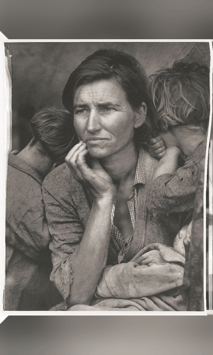

# HoloForge

HoloForge is a private, local converter that turns one conventional photograph into a
multi-view Looking Glass quilt. It is aimed at photographs where ordinary RGB-D warping
leaves grey/stretchy bands around people and makes faces look like cardboard cut-outs.

This is an early working prototype, not an official Looking Glass Factory product.



Demo: Dorothea Lange, *Migrant mother and children – California* (1936), cropped
from the [Library of Congress scan](https://www.loc.gov/pictures/item/93506674/).
The FSA/OWI collection lists no known publication restrictions. The animated image
is a HoloForge reconstruction: newly revealed pixels are generated, not historical evidence.

## What is different

A basic RGB-D converter estimates one depth value per visible pixel, shifts those pixels,
and has nothing to show when a foreground object moves aside. HoloForge instead builds a
small layered scene:

1. Depth Anything V2 Large estimates fine relative depth.
2. An expanded spheroidal head prior adds relief to the cranium, cheeks, and nose;
   view-dependent head-edge extrusion supplies a narrow textured side surface before
   the reconstructed background becomes visible.
3. Two depth thresholds identify surfaces that will be exposed by parallax.
4. LaMa removes masked objects into a coherent coarse backplate; a restrained SDXL pass
   refines its texture while depth inpainting reconstructs hidden geometry. Each generated
   plate is visible only inside its own reconstruction mask, preventing shifted duplicate
   faces from leaking into extreme views.
5. A CUDA forward-splat renderer projects the shared scene through 60 viewpoints with a
   real z-buffer.
6. Views are packed bottom-left to top-right using Looking Glass quilt ordering.

The centre view remains the original photograph. Generated content only becomes visible
at disocclusions in off-axis views, which greatly reduces identity drift and view-to-view
flicker.

## Hardware

The high-quality defaults target an NVIDIA RTX 4090 with 24 GB VRAM and roughly 60–120
seconds per image after model warm-up. CUDA 13 wheels are installed on Windows and Linux.
Apple Silicon installs CPU PyTorch and will work, but the generative path is not expected
to meet that timing target.

Model downloads on first use are several gigabytes and do not count toward conversion
time. After download, photographs and inference remain local.

## Install

### Windows

Open PowerShell in the cloned repository:

```powershell
.\install.ps1
.\run.ps1
```

The installer uses the `uv` Python manager. If it is not already present, Windows `winget`
installs it. The application opens a local browser UI.

### Linux / macOS

Install [`uv`](https://docs.astral.sh/uv/), then:

```bash
chmod +x install.sh run.sh
./install.sh
./run.sh
```

## Command line

```powershell
uv run holoforge "photo.jpg" --preset musubi --inpaint generative
```

Useful alternatives:

```powershell
# Quick diagnostic without diffusion
uv run holoforge "photo.jpg" --preset preview --inpaint fast

# Preserve the full image over a blurred ambient field
uv run holoforge "photo.jpg" --layout ambient

# Override a future official display grid without changing code
uv run holoforge "photo.jpg" --columns 10 --rows 6 --quilt-size 8192 --aspect 0.5625
```

Each run creates a folder under `outputs/` containing:

- the named quilt;
- a left-to-right wiggle GIF;
- the centre view;
- explicit left/right endpoint images and a side-by-side endpoint audit;
- depth, face, layer-mask, and generated-backplate diagnostics;
- `conversion.json` with every setting required to reproduce the run.

## Musubi status

Looking Glass publicly specifies musubi as a portrait 9:16 HLD device and says its own
converter uses local AI-powered Gaussian splatting. As of this prototype, Looking Glass
has not published a final developer quilt grid for musubi. The `musubi` preset therefore
uses the 10×6 grid seen in current Blocks exports with the published 9:16 content aspect;
all four values are CLI-overridable once an official specification appears.

The standard presets use Looking Glass' published layouts:

- Portrait: 8×6 at 3360×3360, aspect 0.75
- Looking Glass 16: 5×9 at 4096×4096, aspect 1.777…

## Honest limits

One photograph does not contain ground-truth pixels from behind a person, nor the true
profile of a face. HoloForge generates a plausible and view-consistent 2.5D reconstruction;
it cannot match a calibrated multi-camera light-field capture in geometric truth. Keep the
view cone conservative. Large rotations expose invented structure and eventually reveal
that the representation is layered rather than a complete 3D scan.

For irreplaceable family photographs, retain the source and inspect `wiggle.gif` before
sharing the quilt. Generated hidden detail is an interpretation, not historical evidence.

## Model licences

- HoloForge source: Apache-2.0.
- Depth Anything V2 **Large** weights: CC-BY-NC-4.0 (non-commercial). Small is Apache-2.0
  and can be selected by changing `depth_model` to
  `depth-anything/Depth-Anything-V2-Small-hf`.
- SDXL inpainting weights: use is governed by the model card and OpenRAIL-family licence
  downloaded with the model.
- LaMa object-removal weights and the small TorchScript wrapper source are Apache-2.0.

The weights are not redistributed by this repository; Hugging Face downloads them into
the user's local cache on first use.

The public demo photograph and generated preview are not included in the HoloForge
software licence; their source and rights information are given above.

## Development

```powershell
uv sync --extra dev
uv run pytest
uv run ruff check src tests
```
