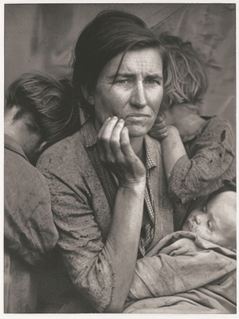
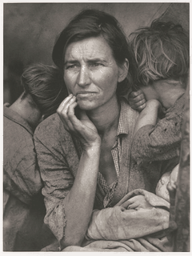
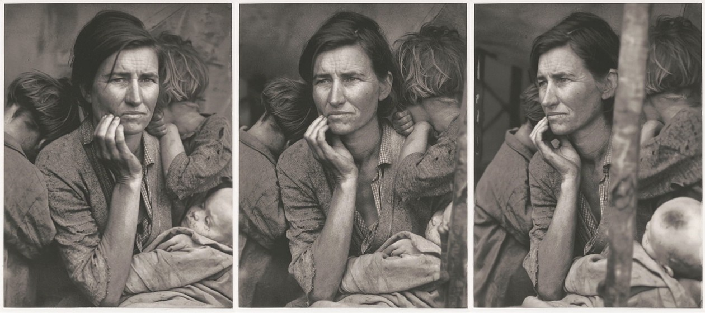

# HoloForge

HoloForge turns one ordinary photograph into a Looking Glass hologram, privately on your own
PC. It asks the [MiniMax H3](https://huggingface.co/MiniMaxAI/MiniMax-H3) video model,
running in your local ComfyUI, to fly a camera round the frozen moment in the photo, then
builds the quilt from real views of the scene from either side, rather than warping a flat
photo over a depth map. With a Looking Glass Portrait plugged in, results go straight onto
its standalone playlist.

This is an early working prototype, not an official Looking Glass Factory product.

| Look-around parallax (all 48 quilt views) | The H3 orbit it was built from |
|---|---|
|  |  |



*Leftmost, centre and rightmost quilt views: her head turns, the children shift, and
the tent pole on the right moves against the background with real parallax.*

Demo: Dorothea Lange, *Migrant mother and children – California* (1936), cropped from the
[Library of Congress scan](https://www.loc.gov/pictures/item/93506674/). The FSA/OWI
collection lists no known publication restrictions. Everything beyond the photographed
viewpoint is generated by H3: an interpretation, not historical evidence.

## How it works

1. The photo is given to MiniMax H3's first-and-last-frame mode (FL2VA) as **both** the first
   and the last frame, so the clip starts and ends on the photographed viewpoint. Pablo
   Dawson's [360° orbit LoRA](https://huggingface.co/pablodawson/MiniMax-H3-360-Orbit-LoRA)
   and its training caption turn that into one continuous camera orbit around a scene frozen
   like a statue: "Only the camera moves." The frames just after the start and just before
   the end show the scene from either side of the original viewpoint.
2. 48 views are placed at evenly spaced viewing angles over `--sweep` degrees, by default 40°:
   the Portrait's own view cone (from its calibration file), so the hologram is orthoscopic
   and the scene turns exactly as far as your eye moves (`--angle-calibration`, default 1.1,
   corrects the LoRA's timing, which viewing on a Portrait showed runs about 10% short). The
   LoRA orbits at constant speed,
   so angles come from how far round its circle the camera has travelled (pauses at either
   end count as zero). The real camera yaw is then measured near the photo on both sides,
   from an essential matrix fitted to the moving features, and each side is rescaled so the
   two turn equally fast. The same fit decides which side the clip leaves towards, so the
   quilt runs from the leftmost view. Where no frame lands close enough to a target angle,
   the two neighbouring frames are blended along their optical flow.
3. Two failures are detected and re-rendered once with a new seed: H3 turning the subjects on
   a turntable in front of a frozen background (which plays back with a flat background), and
   H3 animating the subjects, a horse finishing its jump say, while the camera barely moves
   (measured from how far the viewpoint really turns).
4. Views are framed into the display aspect and packed into a quilt. When a Portrait is
   connected, the quilt is also rendered as a Portrait playback video and added to its
   playlist (see below).

Without the LoRA (`--no-lora`), the base model is steered by a descriptive prompt instead,
optionally written by a local Ollama vision model (`qwen2.5vl:7b`).

## Install

On Windows, in PowerShell in the cloned repository:

```powershell
.\install.ps1
.\run.ps1
```

On Linux or macOS, install [`uv`](https://docs.astral.sh/uv/) and ffmpeg (`brew install ffmpeg`
or `sudo apt install ffmpeg`), then run `./install.sh` and `./run.sh`.

The installer sets up HoloForge itself (a light Python app with no PyTorch, using the `uv`
Python manager, which it installs with `winget` if needed), then offers the one-time
rendering setup, `holoforge-setup`, which you can also run later with `uv run holoforge-setup`:

1. **ComfyUI.** Give it the folder of a ComfyUI you already have, or let it clone a fresh one
   into `tools\comfyui` with its own Python environment and CUDA PyTorch (about 6 GB; git
   required). Either way it adds the [ComfyUI-GGUF](https://github.com/city96/ComfyUI-GGUF)
   nodes if they are missing; it never updates or reinstalls anything in a ComfyUI it did not
   install itself.
2. **Models.** After you confirm the MiniMax H3 licence covers you (see Licences), it
   downloads the four files below from Hugging Face into ComfyUI's `models` folders, about
   34 GB in total.
3. **ffmpeg.** On Windows it downloads the free [gyan.dev](https://www.gyan.dev/ffmpeg/builds/)
   build into `tools\ffmpeg`; elsewhere it uses the ffmpeg on your PATH.

| folder | file | source |
|---|---|---|
| `diffusion_models` | `MiniMax-H3-FL2VA-Pruned-Q5_K_M.gguf` (14.1 GB) | [Abiray/MiniMax-H3-Pruned-GGUF](https://huggingface.co/Abiray/MiniMax-H3-Pruned-GGUF) |
| `text_encoders` | `qwen3vl-32B-MiniMax-H3-Q4_K_M.gguf` (14.6 GB) | [realrebelai/MiniMax-H3_GGUFs](https://huggingface.co/realrebelai/MiniMax-H3_GGUFs) |
| `vae` | `minimax_h3_video_vae_fp16.safetensors` (5.2 GB) | [Comfy-Org/MiniMax-H3](https://huggingface.co/Comfy-Org/MiniMax-H3) (`vae/`) |
| `loras` | `minimax_h3_flf2v_lora_v1.safetensors` (0.2 GB) | [pablodawson/MiniMax-H3-360-Orbit-LoRA](https://huggingface.co/pablodawson/MiniMax-H3-360-Orbit-LoRA) |

The choices are saved in `~/.holoforge/config.json`. When ComfyUI isn't running, HoloForge
starts it in its own window as a conversion begins (for a ComfyUI it can find the Python for;
pass `--comfy-python` to `holoforge-setup` if it can't). Other quantisations work too:
`--unet`, `--clip` and `--vae` pick different files, and non-GGUF files (such as Comfy-Org's
int8 and nvfp4 repacks) load with ComfyUI's core loaders.

If another pipeline shares the GPU, add `gpu_request_flag` and `gpu_go_flag` (file paths) to
that config: before rendering, HoloForge creates the request file, waits for the other pipeline
to write the go file, and deletes the request file when it is done.

On an RTX 4090 (24 GB) a 141-frame 768p orbit, the longest that stays inside 24 GB, takes
about 15 minutes at the default 28 steps. `--pdd` uses the 8-step PDD distillation
([alibaba-pai/MiniMax-H3-Acc-LoRAs](https://huggingface.co/alibaba-pai/MiniMax-H3-Acc-LoRAs))
for about 2.5x speed at some cost in fidelity.

## Use

### Web app

`.\run.ps1` (or `uv run holoforge-ui`) opens HoloForge in your browser. Choose a photo and
press **Forge hologram**. The page shows the generated orbit video, a parallax preview, the
measured viewing angles, the quilt and, with a Portrait connected, its playback video, which
is also added to the device's playlist. The address is printed in the terminal; it is usually
`http://127.0.0.1:7860`, or another free port when Windows has reserved that range.
`--output` picks the results folder (default `outputs`); pointing it at the folder of an
earlier command-line batch reuses that batch's H3 clips, so a photo it has already
rendered (with the same seed and settings) is ready in about a minute.

### Command line

```powershell
uv run holoforge "photo.jpg"                     # quilt in outputs\photo\
uv run holoforge "D:\Photos\Birthday" --push     # a whole folder, added to the Portrait
uv run holoforge "photo.jpg" --sweep 30          # gentler than orthoscopic 3D
uv run holoforge "photo.jpg" --preset lg16       # other Looking Glass displays
```

Each photo gets a folder under `outputs/` with:

- the quilt (`*_qs8x6a0.75.jpg`, named so Looking Glass software reads its layout);
- a parallax preview GIF and the centre view;
- `videos/`, an MP4 of every H3 clip generated for it;
- `parallax.png`, the viewing angle of each frame against the chosen views;
- the Portrait playback video when a Portrait is connected;
- `conversion.json`, with every setting needed to reproduce the run.

The H3 frames are kept under `orbit/` and reused while the settings are unchanged, so trying a
different `--sweep` or framing takes about a minute instead of another 15-minute render.

HoloForge shares ComfyUI politely: on the command line, each H3 job waits until ComfyUI's
queue has been empty for `--idle-seconds` (default 180), so another pipeline keeps the GPU
while it is busy. Use `--idle-seconds 0` when the GPU is yours.

### Displays

| preset | quilt | aspect |
|---|---|---|
| `portrait` (default) | 8×6 at 3360×3360 | 0.75 |
| `lg16` | 5×9 at 4096×4096 | 16:9 |
| `musubi` | 10×6 at 8192×8192 | 9:16 |

Looking Glass has not published a final developer quilt grid for musubi; its preset uses the
grid seen in Blocks exports with the published 9:16 aspect. `--columns`, `--rows`,
`--quilt-size` and `--aspect` override any preset.

## Looking Glass Portrait standalone playback

In standalone mode the Portrait doesn't play quilts. It plays videos that Looking Glass
Studio pre-renders through its lenticular shader (3072×2048 HEVC files named
`<quilt>__lkgrec.mp4`), listed in `playlist.json` and `playlist.m3u` on the Portrait's USB
drive. HoloForge does the same itself:

- it reads the Portrait's own calibration from `LKG_calibration/visual.json`;
- it reproduces Studio 1.7's `quilt_to_lent` shader and the values Studio logs for it;
- it encodes HEVC with the free x265 encoder, at a quality setting measured to keep the
  lenticular pattern at least as faithfully as Studio's own encoder.

Looking Glass Studio is not needed.

```powershell
uv run holoforge-portrait "outputs\photo\photo_quilt_qs8x6a0.75.jpg"   # any existing quilt
uv run holoforge-portrait (Get-ChildItem outputs\*\*_qs8x6a0.75.jpg) --replace   # only these
```

New items go to the front of the playlist and existing ones are kept; `--replace` instead
makes the Portrait play only the given quilts, in order, and deletes every other recording on
it. The original playlists are backed up once as `*.holoforge-backup`. To view them, eject the Portrait's drive, unplug
it from the computer and power it from USB-C alone. A later sync from Looking Glass Studio
rewrites the playlist from Studio's own library and may drop these items.

## Honest limits

One photograph doesn't contain the far side of anyone. H3 invents everything beyond the
photographed viewpoint; the quilt only uses ±20° of the orbit by default, where the invention
is modest and the real photo dominates, but expressions can still shift slightly and hidden
detail is an interpretation. For irreplaceable family photographs, keep the original and
check the parallax preview before sharing.

## Licences

- HoloForge source: Apache-2.0.
- MiniMax H3 weights, their quantised repacks, and the orbit LoRA trained on them: the
  [MiniMax H3 Community License](https://huggingface.co/MiniMaxAI/MiniMax-H3/blob/main/LICENSE),
  which excludes the EU, UK, South Korea and USA unless MiniMax grants a separate licence.
  Check that it covers you before downloading the models.

No model weights are distributed with HoloForge. The demo photograph and its generated
previews are not covered by the HoloForge licence; their source and rights are given above.

## Development

```powershell
uv sync --extra dev
uv run pytest
uv run ruff check src tests
```
